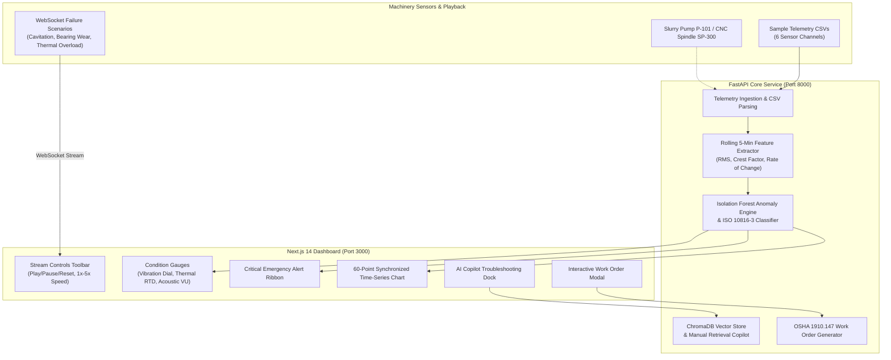

# FactoryPilot 🏭

> **Industrial Machinery AI Telemetry Ingestion, ML Anomaly Engine & Vector RAG Copilot**  
> Real-time ISO 10816-3 vibration severity analytics, thermal trip monitoring, full-duplex WebSocket telemetry streaming, and OSHA 1910.147 compliant maintenance work order dispatch.

[](.github/workflows/ci.yml)
[](backend/)
[](frontend/)
[](backend/app/api/v1/endpoints/stream.py)
[](docs/manuals/)
[](docker-compose.yml)
[](docker-compose.yml)

---

## 📑 Table of Contents
1. [Executive Summary & Features](#1-executive-summary--key-features)
2. [Quickstart (One-Command Runners)](#2-quickstart-one-command-runners)
3. [Automated System Verification Suite](#3-automated-system-verification-suite)
4. [Architecture & Topology](#4-system-architecture--data-lifecycle)
5. [UI Tour & Plant Floor Gauges](#5-ui-tour--plant-floor-condition-gauges)
6. [Docker Multi-Container Orchestration](#6-docker-multi-container-orchestration)
7. [Industrial Machine Manuals & Standards](#7-industrial-machine-manuals--standards)
8. [Contributor Profiles](#8-core-engineering-team)

---

## 1. Executive Summary & Key Features

FactoryPilot bridges the gap between raw high-frequency sensor streams and actionable plant floor maintenance interventions:

- ⚡ **Real-Time WebSocket Streaming Engine**: Full-duplex WebSocket stream (`ws://localhost:8000/api/v1/telemetry/ws/stream`) with auto-reconnect, playback controls (Play, Pause, Reset, 1x/2x/5x speed), and deterministic physical failure generators (Centrifugal Pump Cavitation, CNC Bearing Wear, Thermal Overload).
- 📊 **Plant Floor Condition Gauges**:
  - **Vibration Severity Meter**: Calibrated against ISO 10816-3 Class II boundaries (Zone A/B `<2.8 mm/s`, Zone C `2.8–7.1 mm/s`, Zone D `>7.1 mm/s`).
  - **Bearing Thermal Monitor**: RTD housing temperature with dynamic color shifts approaching and exceeding the $80^\circ\text{C}$ threshold.
  - **Acoustic Sensor Monitor**: 12-segment VU meter detecting high-frequency ultrasonic cavitation shockwaves ($>85\text{ dB}$).
- 🚨 **Emergency Alert Ribbon**: Audio-visual pulsing alert header triggered on `Critical` conditions, displaying offending sensors and an immediate OSHA 29 CFR 1910.147 "LOTO Protocol Advised" badge.
- 🤖 **Vector RAG Diagnostic Copilot**: Queries technical manuals (`centrifugal_pump_manual.md`, `cnc_milling_spindle_manual.md`) via ChromaDB / TF-IDF semantic search to return root-cause rankings, exact chapter citations, and sequential field inspection steps.
- 📋 **Maintenance Work Order Dispatch**: Exports signed, OSHA-compliant Markdown (`.md`) and JSON work orders capturing live sensor snapshots, active checklists, and mitigation procedures (`POST /api/v1/diagnostics/export-ticket`).

---

## 2. Quickstart (One-Command Runners)

Start both the FastAPI backend (with vector embeddings seeded) and Next.js frontend concurrently with a single command:

### 🪟 Windows (CMD / PowerShell):
```cmd
scripts\run_local.bat
```

### 🍎 Linux / macOS:
```bash
chmod +x scripts/run_local.sh
./scripts/run_local.sh
```

Both runners automatically:
1. Verify system prerequisites (Python 3.10+, Node.js 18+, npm, Docker).
2. Set up Python virtual environment (`backend/.venv`) and install dependencies.
3. Seed technical manual semantic vector embeddings.
4. Install frontend npm dependencies if needed.
5. Concurrently launch Uvicorn (`http://localhost:8000`) and Next.js (`http://localhost:3000`).
6. Gracefully terminate all child background processes upon `Ctrl+C`.

---

## 3. Automated System Verification Suite

Run our automated end-to-end smoke test to validate all 6 subsystems in seconds:

```bash
python scripts/verify_system.py
```

### Verification Output:
```
============================================================================
   FACTORYPILOT SYSTEM HEALTHCHECK & END-TO-END VERIFICATION SUITE   
============================================================================

[*] Target Backend:  http://localhost:8000
[*] Target Frontend: http://localhost:3000
----------------------------------------------------------------------------

[1/6] Testing Backend Connectivity & Core Services (/api/v1/health)...
      [ PASS ] in 12.4ms - Status: healthy | RAG: active (14 chunks) | ML: operational

[2/6] Testing Industrial Telemetry Ingestion (/api/v1/telemetry/upload)...
      [ PASS ] in 45.2ms - Ingested 5 rows for PUMP-01 | Features extracted

[3/6] Testing ML Anomaly Engine & Health Index (/api/v1/telemetry/upload-and-analyze)...
      [ PASS ] in 62.1ms - EHI: 54.0% | State: Degraded | ISO: Zone C (Warning)

[4/6] Testing Technical Manual Vector RAG Copilot (/api/v1/diagnostics/troubleshoot)...
      [ PASS ] in 84.8ms - Retrieved 2 citations (centrifugal_pump_manual.md) | 4 inspection steps

[5/6] Testing Maintenance Ticket & Work Order Export (/api/v1/diagnostics/export-ticket)...
      [ PASS ] in 28.3ms - Generated Work Order: WO-PUMP-01-20261018-7F3A2E (LOTO compliant)

[6/6] Testing Next.js Frontend Web Application (http://localhost:3000)...
      [ PASS ] in 31.0ms - Next.js App Router live & serving dashboard

============================================================================
                      SUBSYSTEM VERIFICATION SUMMARY                        
============================================================================
Subsystem / Test Case            | Result     | Latency   | Details
----------------------------------------------------------------------------
Backend Service Health           | PASS       |   12.4ms  | Status: healthy
Telemetry Ingestion (CSV)        | PASS       |   45.2ms  | Ingested 5 rows
ML Anomaly Engine & EHI          | PASS       |   62.1ms  | EHI: 54.0%
Vector RAG Copilot               | PASS       |   84.8ms  | Retrieved 2 citations
Work Order Ticket Generator      | PASS       |   28.3ms  | Generated Work Order
Next.js Frontend UI              | PASS       |   31.0ms  | Next.js App Router
============================================================================
  ✓ ALL SYSTEM VERIFICATION CHECKS PASSED SUCCESSFULLY. READY FOR DEMO!
```

---

## 4. System Architecture & Data Lifecycle

FactoryPilot implements a modular, high-throughput pipeline designed for low-latency edge deployment:



> For deep architectural details and mathematical formulations, consult **[docs/ARCHITECTURE.md](docs/ARCHITECTURE.md)**.  
> For the 3-minute hackathon pitch script, see **[docs/DEMO_WALKTHROUGH.md](docs/DEMO_WALKTHROUGH.md)**.

---

## 5. UI Tour & Plant Floor Condition Gauges

```
+-----------------------------------------------------------------------------------------+
| [FactoryPilot PROD v0.2.0]        [PUMP-01 (Slurry Booster)]  [CNC-SPINDLE-01]  Live: OK |
+-----------------------------------------------------------------------------------------+
| 🚨 CRITICAL FAULT: Vibration Severity: 7.85 mm/s (Zone D Trip) | [LOTO Protocol Advised] |
+-----------------------------------------------------------------------------------------+
| [▶ Play] [⏸ Pause] [↺ Reset] [1x][2x][5x] | Scenario: [CNC Bearing Wear ▼] | Live Stream |
+-----------------------------------------------------------------------------------------+
|  EHI: 54%  |  State: DEGRADED  |  ISO 10816: Zone C Alert  |  [Export Work Order Button] |
+-----------------------------------------------------------------------------------------+
|  +--------------------+   +--------------------+   +---------------------------------+  |
|  | VIBRATION SEVERITY |   |  BEARING THERMAL   |   |       ACOUSTIC INTENSITY        |  |
|  |   7.85 mm/s        |   |     82.4 °C        |   |             94.2 dB             |  |
|  | [Zone D Critical]  |   | [Overheat Warning] |   | [VU Meter: Cavitation Detected] |  |
|  +--------------------+   +--------------------+   +---------------------------------+  |
+-----------------------------------------------------------------------------------------+
|  +---------------------------------------------+ +-----------------------------------+  |
|  | MULTI-METRIC TELEMETRY TIME-SERIES (60 PTS) | | AI DIAGNOSTIC COPILOT DOCK        |  |
|  | - Vibration Velocity RMS (mm/s)             | | "Severe cavitation noise..."      |  |
|  | - Bearing Housing Temp (°C)                 | | 📖 Section 4.3 (Pump Manual)     |  |
|  | - Motor Current Draw (Amps)                 | | ⚠️ OSHA 1910.147 LOTO Mandatory   |  |
|  +---------------------------------------------+ +-----------------------------------+  |
+-----------------------------------------------------------------------------------------+
```

---

## 6. Docker Multi-Container Orchestration

Deploy the complete stack in isolated, non-root Linux containers:

```bash
# 1. Initialize environment configuration
cp .env.example .env

# 2. Build and launch containers
docker compose up --build -d

# 3. Check health and status
docker compose ps
```

| Service | Port | Technology | Healthcheck URL |
| :--- | :--- | :--- | :--- |
| **`frontend`** | `3000` | Next.js 14, Tailwind CSS, TypeScript | `http://localhost:3000` |
| **`backend`** | `8000` | FastAPI, Uvicorn, Python 3.11 | `http://localhost:8000/api/v1/health` |
| **`chromadb`** | `8001` | ChromaDB Vector Store | `http://localhost:8001/api/v1/heartbeat` |

---

## 7. Industrial Machine Manuals & Standards

FactoryPilot indexes realistic OEM documentation located under `docs/manuals/`:
- **[Centrifugal Slurry Pump Manual](docs/manuals/centrifugal_pump_manual.md)**: Class II ISO 10816 vibration zoning, $80^\circ\text{C}$ thermal advisory, cavitation acoustic frequency envelopes, and 6-step LOTO checklist.
- **[CNC Milling Spindle Manual](docs/manuals/cnc_milling_spindle_manual.md)**: $24,000\text{ RPM}$ continuous speed envelope, $\le 2\text{ }\mu\text{m}$ radial runout tolerances, $18.5\text{ A}$ FLA current limits, and hybrid ceramic bearing run-in cycles.

---

## 8. Core Engineering Team

Built with precision for the Hackathon by:

- **[Jay Bhadoria](https://github.com/JayBhadoria11)** — DevOps, Universal Orchestration, System Verification & Pitch Guide
- **[Shobhit Singh Baghel](https://github.com/Shobhit-S-Baghel)** — Live WebSocket Streaming, Plant Condition Gauges, Next.js Dashboard & Work Order Generator
- **[Satvik Bade](https://github.com/satvikbade-01)** — ML Anomaly Engine, Isolation Forest, ISO 10816 Evaluator & ChromaDB RAG Architecture

---

## 9. License

Licensed under the **Apache 2.0 License**. Built for mission-critical manufacturing uptime and operator safety.
