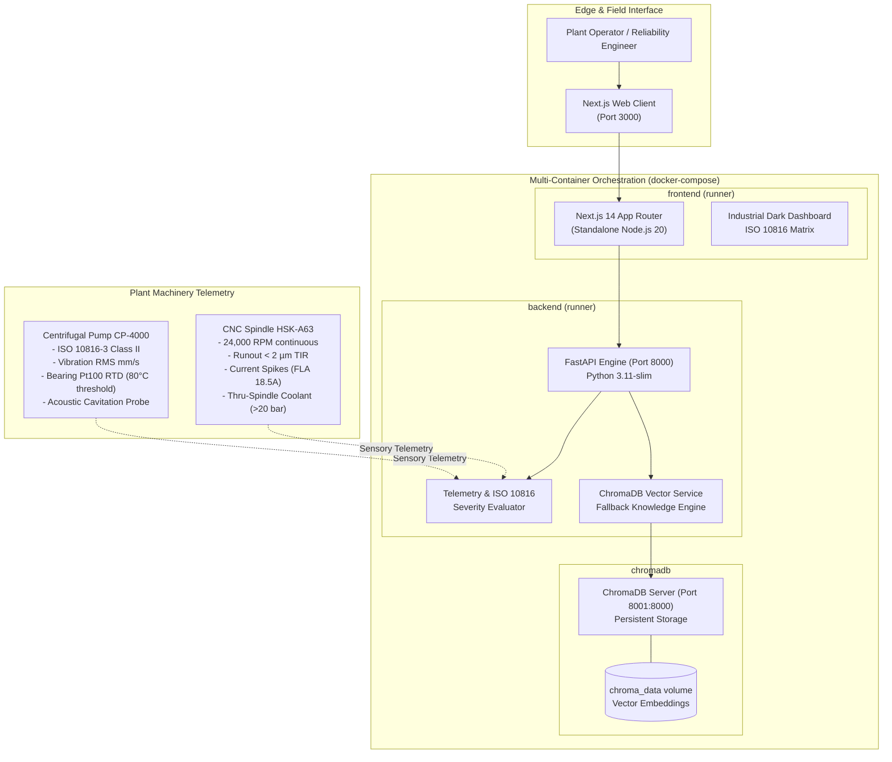

# FactoryPilot 🏭

> **Industrial Machinery AI & Telemetry Platform**  
> Real-time ISO 10816 vibration severity analytics, thermal trip monitoring, and semantic vector retrieval for plant operating manuals.

[](.github/workflows/ci.yml)
[](backend/)
[](frontend/)
[](docker-compose.yml)
[](docker-compose.yml)

---

## 1. System Architecture

FactoryPilot coordinates sensory telemetry acquisition from high-value industrial machinery (centrifugal slurry pumps, 5-axis CNC electro-spindles) alongside automated RAG knowledge retrieval from plant standard operating procedures (SOPs).

### Topology Diagram (Mermaid)



### ASCII Architecture Overview

```
+-----------------------------------------------------------------------------------------+
|                                    FACTORYPILOT TOPOLOGY                                |
+-----------------------------------------------------------------------------------------+
|                                                                                         |
|  [ PLANT OPERATOR / SCADA CLIENT ]                                                      |
|                 |                                                                       |
|                 v                                                                       |
|  +-----------------------------------+        +--------------------------------------+  |
|  |       FRONTEND SERVICE            |        |           BACKEND SERVICE            |  |
|  |   Next.js 14 + Tailwind CSS       | -----> |          FastAPI + Uvicorn           |  |
|  |   Container: factorypilot-frontend| HTTP   |   Container: factorypilot-backend    |  |
|  |   Port: 3000:3000                 | /JSON  |   Port: 8000:8000                    |  |
|  |   User: nextjs (UID 1001)         |        |   User: factorypilot (UID 10001)     |  |
|  +-----------------------------------+        +--------------------------------------+  |
|                                                              |                          |
|                                               ChromaDB HTTP  | Query / Embeddings       |
|                                               Client Vector  v                          |
|                                       +----------------------------------------------+  |
|                                       |           CHROMADB VECTOR STORE              |  |
|                                       |   Container: factorypilot-chromadb           |  |
|                                       |   Host Port: 8001 | Container Port: 8000     |  |
|                                       |   Volume: chroma_data -> /chroma/chroma      |  |
|                                       +----------------------------------------------+  |
+-----------------------------------------------------------------------------------------+
```

---

## 2. Component Matrix

| Service | Host Port | Technology Stack | Security / Non-Root User | Healthcheck Endpoint | Description |
| :--- | :--- | :--- | :--- | :--- | :--- |
| **`frontend`** | `3000` | Next.js 14, React 18, Tailwind CSS, TypeScript | `nextjs:nodejs` (UID 1001) | `http://localhost:3000/` | Industrial diagnostics dashboard, ISO 10816 severity matrix, and RAG query interface. |
| **`backend`** | `8000` | FastAPI, Pydantic v2, Uvicorn, Python 3.11-slim | `factorypilot:factorypilot` (UID 10001) | `http://localhost:8000/health` | RESTful API for machine telemetry, vibration analysis, and vector retrieval. |
| **`chromadb`** | `8001` (internal `8000`) | ChromaDB 0.4.24, DuckDB / SQLite, HNSW index | Standalone Container User | `http://localhost:8001/api/v1/heartbeat` | Vector database storing technical manuals, maintenance procedures, and OSHA LOTO protocols. |

---

## 3. Setup Prerequisites

Ensure you have the following installed locally:
- **Docker Engine** (v24.0+) & **Docker Compose** (v2.20+)
- **Node.js** (v20.x LTS) & **npm** (v10.x+) *(for bare-metal development)*
- **Python** (v3.11.x+) & **pip** *(for bare-metal development)*
- **Git**

---

## 4. Step-by-Step Local Boot Commands

### Option A: Complete Multi-Container Orchestration (Recommended)

1. **Clone and Enter Repository**:
   ```bash
   git clone https://github.com/JayBhadoria11/FactoryPilot.git
   cd FactoryPilot
   ```

2. **Initialize Environment Configuration**:
   ```bash
   cp .env.example .env
   ```

3. **Build and Launch via Docker Compose**:
   ```bash
   docker compose up --build -d
   ```

4. **Verify Container Health & Logs**:
   ```bash
   docker compose ps
   docker compose logs -f
   ```

5. **Access Application Interfaces**:
   - **Frontend UI**: [http://localhost:3000](http://localhost:3000)
   - **FastAPI OpenAPI Swagger**: [http://localhost:8000/docs](http://localhost:8000/docs)
   - **Backend Health Check**: [http://localhost:8000/health](http://localhost:8000/health)
   - **ChromaDB Heartbeat**: [http://localhost:8001/api/v1/heartbeat](http://localhost:8001/api/v1/heartbeat)

6. **Tear Down**:
   ```bash
   docker compose down -v
   ```

---

### Option B: Bare-Metal Local Development (Without Docker)

#### 1. Start the FastAPI Backend:
```bash
cd backend
python -m venv .venv

# On Linux / macOS:
# source .venv/bin/activate
# On Windows (PowerShell):
.venv\Scripts\Activate.ps1

pip install --upgrade pip
pip install -r requirements.txt
uvicorn app.main:app --host 0.0.0.0 --port 8000 --reload
```

#### 2. Start the Next.js Frontend:
```bash
# In a new terminal window:
cd frontend
npm install
npm run dev
```
Navigate to [http://localhost:3000](http://localhost:3000).

---

## 5. Industrial Machine Manuals Reference

The repository provides realistic standard operating procedures and technical manuals under `docs/manuals/`:

- **[Centrifugal Slurry Pump Manual (`docs/manuals/centrifugal_pump_manual.md`)](docs/manuals/centrifugal_pump_manual.md)**:
  - **ISO 10816 Vibration Zones**: Class I-IV criteria, Zone A ($<1.4\text{ mm/s}$) to Zone D ($>4.5\text{ mm/s}$ trip).
  - **Thermal Thresholds**: Bearing alarms at $>80^\circ\text{C}$, catastrophic emergency shutdown at $>95^\circ\text{C}$.
  - **Cavitation Warning Patterns**: Ultrasonic high frequency ($10-35\text{ kHz}$), gravel pumping sound, and $\text{NPSH}_a$ deficiency.
  - **Lubrication Schedules**: NLGI Grade 2 Lithium-Complex grease every 2,000 operational hours.
  - **Mandatory LOTO Protocol**: OSHA 29 CFR 1910.147 compliant 6-step zero energy lockout sequence.

- **[CNC Milling Spindle Manual (`docs/manuals/cnc_milling_spindle_manual.md`)](docs/manuals/cnc_milling_spindle_manual.md)**:
  - **RPM Envelopes**: $24,000\text{ RPM}$ continuous rating, $30,000\text{ RPM}$ peak.
  - **Runout Tolerances**: Spindle nose radial/axial runout $\le 0.0020\text{ mm}$ ($2\text{ }\mu\text{m}$) TIR.
  - **Current Draw Spikes**: Baseline idle $4.2\text{ A}$, FLA $18.5\text{ A}$, automated feed hold on $>125\%$ FLA.
  - **Coolant Flow Diagnostics**: Motor chiller $\Delta T \le 3.5^\circ\text{C}$; Thru-Spindle Coolant (TSC) $\ge 20.0\text{ bar}$.
  - **Hybrid Ceramic Bearing Replacement**: Cleanroom ISO 7 assembly, induction heating to $80^\circ\text{C}$, automated speed run-in cycling.

---

## 6. Testing & CI/CD Verification

Automated quality gates are enforced via `.github/workflows/ci.yml`.

### Run Backend Tests & Linting:
```bash
cd backend
ruff check .
ruff format --check .
pytest -v tests/
```

### Run Frontend Typecheck & Build:
```bash
cd frontend
npm run type-check
npm run lint
npm run build
```

---

## 7. License

Licensed under the Apache 2.0 License. Designed for mission-critical industrial manufacturing operations.
