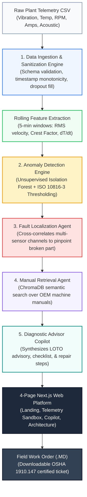
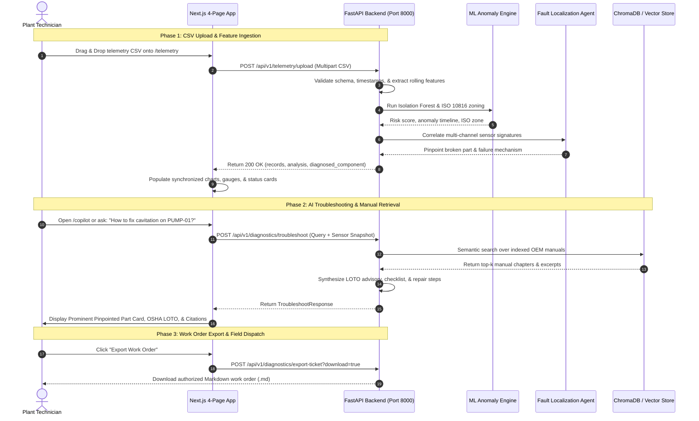

# FactoryPilot: Complete System Architecture & 5-Agent Pipeline Specification

> **FactoryPilot** is a production-grade predictive maintenance platform and vector Retrieval-Augmented Generation (RAG) assistant designed for mission-critical manufacturing assets. It transforms raw industrial sensor telemetry into pinpointed mechanical component diagnoses, OSHA-compliant safety procedures, and authorized maintenance work orders.

---

## 1. End-to-End Data Flow Pipeline

The end-to-end data lifecycle moves seamlessly from physical machine sensors to the floor technician's screen through five specialized AI engines and agents:

### 1.1 ASCII Data Pipeline Diagram
```
┌─────────────────┐      ┌─────────────────────────┐      ┌─────────────────────────┐
│     Raw CSV     │ ───► │   Feature Extraction    │ ───► │   ML Anomaly Scoring    │
│ Plant Telemetry │      │ (RMS, Crest, Temp Rate) │      │ (Isolation Forest + ISO)│
└─────────────────┘      └─────────────────────────┘      └────────────┬────────────┘
                                                                       │
┌─────────────────┐      ┌─────────────────────────┐                   ▼
│  Technician UI  │ ◄─── │  Vector Manual Search   │ ◄─── ┌─────────────────────────┐
│ Next.js Platform│      │ (ChromaDB Plant Manuals)│      │  Sub-Component Mapping  │
│(Dashboard/Chat) │      │  OSHA 1910.147 LOTO     │      │(Pinpoint Faulty Part)   │
└─────────────────┘      └─────────────────────────┘      └─────────────────────────┘
```

### 1.2 Mermaid Architecture Flowchart


---

## 2. The 5 Specialized Agents & Engines (Plain-Language Roles)

FactoryPilot breaks down complex industrial predictive maintenance into five dedicated, modular engines. Below is what each engine does in plain, accessible terms alongside its technical mechanisms:

```
┌─────────────────────────────────────────────────────────────────────────────┐
│                          THE 5 AGENTS OF FACTORYPILOT                       │
├──────────────────────────┬──────────────────────────────────────────────────┤
│ 1. Ingestion Engine      │ Validates data, timestamps, and calculates stats │
├──────────────────────────┼──────────────────────────────────────────────────┤
│ 2. Anomaly Engine        │ Flags abnormal behavior against ISO boundaries   │
├──────────────────────────┼──────────────────────────────────────────────────┤
│ 3. Fault Localization    │ Pinpoints the exact broken machine sub-component │
├──────────────────────────┼──────────────────────────────────────────────────┤
│ 4. Manual Retrieval      │ Finds relevant repair guides in vector database  │
├──────────────────────────┼──────────────────────────────────────────────────┤
│ 5. Diagnostic Copilot    │ Generates safety steps, checklists, & work orders│
└──────────────────────────┴──────────────────────────────────────────────────┘
```

### 1. Data Ingestion & Sanitization Engine
* **Plain-Language Summary:** The gatekeeper of factory data. It reads incoming plant CSV files or live sensor streams, verifies that the numbers make physical sense, ensures clock timestamps are in chronological order, and calculates essential rolling statistical metrics like vibration intensity and impact spikes.
* **Core Responsibilities:**
  - Validates required industrial channels: `timestamp`, `machine_id`, `rotational_speed_rpm`, `vibration_rms_mms`, `bearing_temperature_c`, `current_draw_amps`, and `acoustic_db`.
  - Enforces monotonic time ordering and applies forward-fill interpolation for intermittent sensor dropouts.
  - Extracts 5-minute rolling window features:
    - **Vibration RMS Velocity ($v_{\text{rms}}$):** Energy measure of continuous machine shaking.
    - **Crest Factor ($CF$):** Ratio of peak impact shock to RMS; reveals early metal flaking.
    - **Thermal Rate of Change ($\frac{dT}{dt}$):** Distinguishes normal room warming from acute friction.
* **Output:** Cleaned, structured feature dataframe ready for machine learning inference.

---

### 2. Anomaly Detection Engine (Isolation Forest & ISO 10816 Thresholding)
* **Plain-Language Summary:** The early-warning radar. It looks across all sensor channels simultaneously to see if the machine is behaving normally or if it has drifted into an abnormal, degraded state. It classifies machine health into standard international vibration zones and gives the asset a simple 0–100% health grade.
* **Core Responsibilities:**
  - **Unsupervised Isolation Forest:** Evaluates multi-dimensional sensor trajectories without needing prior failure labels, producing an anomaly score between $0.00$ and $1.00$.
  - **ISO 10816-3 Vibration Severity Classification:**
    - **Zone A/B (Nominal):** $< 2.80\text{ mm/s}$ — Machine runs smoothly; unrestricted operation.
    - **Zone C (Warning / Alert):** $2.80 - 7.10\text{ mm/s}$ — Deterioration detected; maintenance required.
    - **Zone D (Critical Danger / Trip):** $> 7.10\text{ mm/s}$ — Immediate emergency stop to prevent destruction.
  - **Equipment Health Index (EHI):** Single composite score from $0\%$ (imminent failure) to $100\%$ (factory new).
* **Output:** Anomaly status, risk percentage, ISO zone label, and anomaly timeline.

---

### 3. Fault Localization Agent
* **Plain-Language Summary:** The mechanical detective. Detecting that a machine is "unhappy" is not enough—a maintenance crew needs to know which specific part is broken. This agent correlates patterns across multiple sensors (like high noise paired with shaking, or high heat paired with electrical surge) to pinpoint the exact failing sub-component.
* **Core Correlation Rules:**
  1. **High Vibration RMS ($>4.5\text{ mm/s}$) + Acoustic Surge ($>85\text{ dB}$):**
     $\to$ Pinpoints **"Centrifugal Pump Impeller"** (Cavitation erosion) or **"Bearing Outer Race Spalling"**.
  2. **Elevated Bearing Temperature ($>80^\circ\text{C}$) + High Vibration ($>2.8\text{ mm/s}$):**
     $\to$ Pinpoints **"Deep Groove Ball Bearing 6205 / Bearing Journal"** (Lubricant breakdown).
  3. **High Current Draw ($>120\%\text{ FLA}$) + High Temperature ($>80^\circ\text{C}$) without High Vibration:**
     $\to$ Pinpoints **"Electric Motor Stator Winding Overload"** (Electrical drag / cooling failure).
  4. **Elevated Crest Factor ($>4.0$) + High RPM ($>15,000\text{ RPM}$):**
     $\to$ Pinpoints **"Spindle Shaft Misalignment / Tool Clamp Runout"** (Unbalance / HSK taper wear).
* **Output:** `diagnosed_component`, `failure_mechanism`, and initial `recommended_action`.

---

### 4. Manual Retrieval Agent (ChromaDB / Vector Store)
* **Plain-Language Summary:** The digital library assistant. Industrial plant manuals contain hundreds of pages of engineering tolerances, lubrication intervals, and safety steps. This agent instantly searches through manufacturer documentation using semantic vector search to find the exact manual chapter and paragraph needed for the diagnosed issue.
* **Core Responsibilities:**
  - Manages persistent ChromaDB vector collections indexed with Markdown technical manuals (`centrifugal_pump_manual.md`, `cnc_milling_spindle_manual.md`).
  - Converts technician symptoms and sensor anomalies into vector embeddings to find semantic matches regardless of exact phrasing.
  - Includes an in-memory TF-IDF cosine similarity fallback to guarantee 100% air-gapped plant operation without external cloud dependencies.
* **Output:** Highly relevant manual citations with chapter numbers, page excerpts, and relevance confidence scores.

---

### 5. Diagnostic Advisor Copilot
* **Plain-Language Summary:** The senior chief engineer at your shoulder. It takes the machine data, the pinpointed part, and the retrieved manual citations, and synthesizes them into an easy-to-follow, step-by-step repair guide. It also enforces mandatory OSHA Lockout/Tagout (LOTO) safety checks before any technician touches the machine.
* **Core Responsibilities:**
  - Enforces **OSHA 29 CFR 1910.147** zero-energy verification (breaker lockout, fluid bleed, CAT-IV meter test).
  - Produces an interactive step-by-step field verification checklist.
  - Generates downloadable, standardized Markdown work orders with single-click export.
* **Output:** Interactive chat guidance, root-cause probability rankings, verified checklists, and formal work order files.

---

## 3. The 4-Page Frontend Application Architecture

FactoryPilot provides a unified user interface divided into four dedicated pages:

```
[ FactoryPilot Navbar ]
   ├── / (Home / Overview)
   ├── /telemetry (Plant Operations & Sandbox)
   ├── /copilot (AI Troubleshooting Assistant)
   └── /architecture (How AI Agents Work)
```

1. **Page 1: Landing Page (`/`):**
   - **Headline:** *"Predict Industrial Machine Failures Before Costly Downtime."*
   - Explains the critical problem: unplanned factory downtime costs $260,000/hour on average, and manual spreadsheet inspection is too slow.
   - Highlights the solution: real-time multi-channel sensor intelligence, automated ISO 10816 compliance, and instant sub-component localization.
   - Prominent Call to Action: *"Open Telemetry Sandbox $\to$"* directing users to `/telemetry`.

2. **Page 2: Plant Operations & Telemetry Sandbox (`/telemetry`):**
   - **Machine Context Cards:** Clear, plain-language summaries of `PUMP-01 (Slurry Booster)` and `CNC-SPINDLE-01 (HSK-A63)`.
   - **Clean Zero-State:** Starts empty with *"Standby Mode / Awaiting Sensor Telemetry"* until a CSV is uploaded.
   - **Quick-Load Presets:** 1-click loading for *"PUMP-01 Cavitation Run"* and *"CNC-SPINDLE-01 Bearing Wear"*.
   - **Synchronized Visuals:** Multi-channel Recharts with shaded anomaly excursion bands, physical condition gauges (vibration dial, thermal gauge, acoustic VU meter), and sensor contribution rankings.

3. **Page 3: AI Diagnostic Copilot (`/copilot`):**
   - **Prominent Top Diagnostic Card:** High-visibility badge displaying the **Identified Faulty Part/Sub-System** and **Primary Failure Mechanism**.
   - **Interactive Chat Interface:** Natural language dialogue connected directly to `/api/v1/diagnostics/troubleshoot`.
   - **OSHA 1910.147 LOTO Advisory:** High-contrast red safety warning.
   - **Interactive Checklist:** Clickable checkboxes that strike through completed inspection steps.
   - **Manual Citation Modals:** Clickable chapter tags opening OEM reference excerpts.

4. **Page 4: Architecture & Agent Roles (`/architecture`):**
   - **5-Agent Role Grid:** Cards explaining the specific duties of the Ingestion Engine, ML Detector, Fault Localizer, Manual Retriever, and Copilot.
   - **Interactive Data Pipeline Flow:** Step-by-step interactive visual representation of the sensor-to-ticket lifecycle.

---

## 4. End-to-End System Sequence Diagram



---

## 5. Industrial Compliance & Safety Standards

| Standard / Policy | Subsystem | Implementation Details |
| :--- | :--- | :--- |
| **OSHA 29 CFR 1910.147** | Safety Isolation | Mandatory 6-step Lockout/Tagout (LOTO) sequence enforced before touching machinery. |
| **ISO 10816-3 (Class II)** | Vibration Severity | RMS velocity thresholds: nominal ($<2.8\text{ mm/s}$), alert ($2.8-7.1\text{ mm/s}$), trip ($>7.1\text{ mm/s}$). |
| **DIN 43760 (Pt100)** | Thermal Monitoring | RTD temperature thresholds: nominal ($<70^\circ\text{C}$), warning ($80^\circ\text{C}$), emergency shutdown ($95^\circ\text{C}$). |
| **NEMA MG-1** | Motor Current | Full Load Amperes (FLA) thresholding with thermal overload trip at $120\%\text{ FLA}$. |
| **Air-Gapped Operation** | Vector RAG | ChromaDB with in-memory TF-IDF cosine fallback for 100% offline, air-gapped plant operation. |
