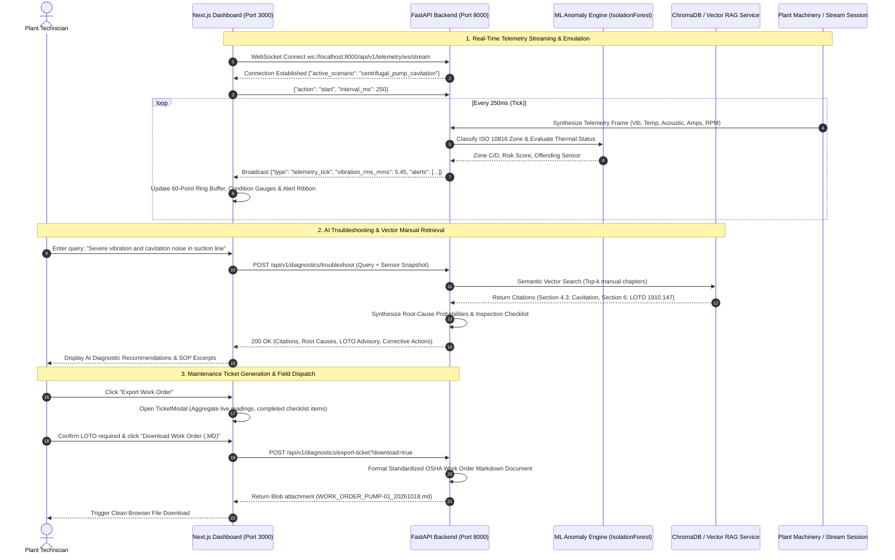

# FactoryPilot: Complete Technical Architecture & Data Lifecycle Specification

> **FactoryPilot** is a production-grade industrial telemetry ingestion engine, machine learning anomaly detection system, and technical manual vector Retrieval-Augmented Generation (RAG) copilot designed for critical manufacturing assets (centrifugal pumps, CNC electro-spindles, turbomachinery).

---

## 1. End-to-End Data Lifecycle

```
[ Industrial Machinery ]
          │
          ▼ (Sensor Acquisition: Triaxial Accel, Pt100 RTD, Hall Effect, Ultrasonic Mic)
[ Ingestion Pipeline ] ──► Schema Validation & Monotonic Time Ordering
          │
          ▼
[ Rolling Feature Extraction ] ──► 5-Min Rolling Windows (RMS, Crest Factor, dT/dt, Kurtosis)
          │
          ▼
[ ML Anomaly Engine ] ──► Isolation Forest + Dynamic Z-Score Attribution + ISO 10816-3 Zoning
          │
          ├───► Equipment Health Index (EHI 0-100%) & Operational State (Nominal/Degraded/Critical)
          │
          ▼
[ ChromaDB Vector RAG ] ──► Semantic SOP & Manual Retrieval, OSHA 1910.147 LOTO Verification
          │
          ▼
[ Next.js Presentation ] ──► Live WebSocket Ring Buffer, Condition Gauges, Work Order Dispatch
```

---

## 2. Comprehensive Data Lifecycle Phases

### Phase 1: Ingestion Pipeline
FactoryPilot supports dual ingestion pathways:
1. **Batch CSV Ingestion (`POST /api/v1/telemetry/upload`)**:
   - Ingests multipart CSV time-series captures.
   - Enforces required industrial channels:
     - `timestamp` (ISO 8601 UTC string or epoch nanoseconds)
     - `machine_id` (Asset tag, e.g. `PUMP-01`, `CNC-SPINDLE-01`)
     - `rotational_speed_rpm` (Shaft rotational velocity)
     - `vibration_rms_mms` (Velocity severity in $mm/s$)
     - `bearing_temperature_c` (Bearing housing RTD sensor in $^\circ C$)
     - `current_draw_amps` (Motor phase current draw in Amperes)
     - `acoustic_db` (Ultrasonic acoustic emission intensity in $dB$)
   - Validates strict monotonic timestamp progression and performs forward-fill interpolation for intermittent sensor dropouts.

2. **Real-Time WebSocket Streaming (`ws://localhost:8000/api/v1/telemetry/ws/stream`)**:
   - High-frequency full-duplex WebSocket channel operating at configurable speeds (1x = 250ms, 2x = 125ms, 5x = 50ms interval).
   - Serves deterministic synthetic failure generators (`centrifugal_pump_cavitation`, `cnc_spindle_bearing_wear`, `thermal_overload_baseline`).
   - Supports bi-directional control frames (`start`, `pause`, `resume`, `seek`, `stop`, `ping`).

---

### Phase 2: Rolling Feature Extraction
Raw high-frequency telemetry is aggregated across rolling 5-minute statistical observation windows:
- **Root-Mean-Square (RMS) Velocity ($v_{\text{rms}}$)**:
  $$v_{\text{rms}} = \sqrt{\frac{1}{N} \sum_{i=1}^N v_i^2}$$
  Calibrated over $10\text{ Hz} - 1,000\text{ Hz}$ per ISO 10816-3.
- **Crest Factor ($CF$)**:
  $$\text{CF} = \frac{|v_{\text{peak}}|}{v_{\text{rms}}}$$
  Quantifies impulsive shock pulses indicative of early spalling on bearing raceways.
- **Thermal Rate of Change ($\frac{dT}{dt}$)**:
  Measures rate of heat buildup to differentiate transient ambient swings from active lubricant film breakdown.
- **Ultrasonic Cavitation Index**:
  Tracks energy surges above $85.0\text{ dB}$ in the $18\text{ kHz} - 35\text{ kHz}$ acoustic spectrum caused by imploding vapor cavity micro-jets.

---

### Phase 3: Machine Learning Anomaly Detection & Attribution
1. **Unsupervised Isolation Forest Engine**:
   - Evaluates multi-dimensional sensor trajectories without requiring pre-labeled training data.
   - Produces an anomaly score normalized between $0.00$ and $1.00$.
2. **Dynamic Sensor Attribution (Z-Score Attribution)**:
   - Computes deviation from nominal rolling baselines:
     $$Z_j = \frac{x_j - \mu_j}{\sigma_j}$$
   - Ranks the primary offending sensor channel driving anomalous behavior (e.g. `vibration_rms_mms: 58%`, `acoustic_db: 24%`).
3. **ISO 10816-3 Standard Vibration Zones**:
   - **Zone A/B (Nominal)**: $< 2.80\text{ mm/s}$ — Unrestricted continuous operation.
   - **Zone C (Warning / Alert)**: $2.80 - 7.10\text{ mm/s}$ — Restricted long-term operation; maintenance scheduled.
   - **Zone D (Critical Danger / Trip)**: $> 7.10\text{ mm/s}$ — Severe risk of catastrophic fatigue; immediate shutdown required.
4. **Equipment Health Index (EHI)**:
   - Composite metric scaled from $0\%$ (imminent failure) to $100\%$ (factory nominal).

---

### Phase 4: ChromaDB Technical Manual Vector RAG Copilot
1. **Document Ingestion & Chunking**:
   - Indexes plant operating manuals (`docs/manuals/centrifugal_pump_manual.md`, `docs/manuals/cnc_milling_spindle_manual.md`).
   - Parses markdown by structural headers (`## 1. Safety`, `## 2. Tolerances`, `## 6. LOTO`), preserving chapter context and table formatting.
2. **Vector Embeddings & Semantic Retrieval**:
   - Embeds technical manual chapters into a persistent ChromaDB vector collection (`factorypilot_manuals`).
   - Includes graceful in-memory TF-IDF cosine similarity fallback to ensure 100% test and deployment reliability without external services.
3. **OSHA 29 CFR 1910.147 LOTO Protocol Verification**:
   - Enforces mandatory 6-step zero-energy isolation validation (MCC breaker lockout, double block & bleed, casing depressurization, CAT-IV multimeter verification) whenever critical faults are diagnosed.

---

### Phase 5: Next.js Presentation & Field Dispatch Layer
1. **Live Circular Ring Buffer**:
   - Frontend maintains a fixed 60-point circular ring buffer in `useTelemetryStream.ts` for continuous smooth charting.
   - Disables chart animation re-triggering (`isAnimationActive={false}`) to guarantee zero frame drops on standard laptop screens.
2. **Plant Floor Status Gauges**:
   - **Vibration Severity Meter**: Semi-circular dial with ISO 10816-3 color bands.
   - **Bearing Thermal Monitor**: Radial and linear progress with dynamic color shifts as temperatures approach and exceed the $80^\circ\text{C}$ threshold.
   - **Acoustic Sensor Monitor**: 12-segment VU meter with peak surge indicators for cavitation detection ($>85\text{ dB}$).
3. **Emergency Alert Ribbon**:
   - Flashes with visual and audible pulses when status hits `Critical`.
   - Displays primary offending sensor and an immediate "LOTO Protocol Advised" badge.
4. **Maintenance Work Order Export Modal**:
   - Compiles live telemetry snapshots, technician checklists, and manual citations into an authorized field work order.
   - Dispatches downloadable Markdown (`.md`) tickets via `POST /api/v1/diagnostics/export-ticket`.

---

## 3. End-to-End System Sequence Diagram



---

## 4. Subsystem Security & Industrial Compliance

| Standard / Policy | Subsystem | Implementation Details |
| :--- | :--- | :--- |
| **OSHA 29 CFR 1910.147** | Safety Isolation | Mandatory 6-step Lockout/Tagout (LOTO) sequence enforcement before machinery casing dismantling. |
| **ISO 10816-3 (Class II)** | Vibration Severity | Rigidly evaluates RMS velocity thresholds: nominal ($<2.8\text{ mm/s}$), alert ($2.8-7.1\text{ mm/s}$), and trip ($>7.1\text{ mm/s}$). |
| **DIN 43760 (Pt100)** | Thermal Monitoring | Temperature limits: continuous nominal ($<70^\circ\text{C}$), advisory warning ($80^\circ\text{C}$), emergency trip ($95^\circ\text{C}$). |
| **Non-Root Containers** | Container Security | Backend executes as UID 10001 (`factorypilot`), Frontend as UID 1001 (`nextjs`). |
| **Stateless REST + WS** | API Architecture | Modular routers with graceful fallback engines for zero-downtime air-gapped plant operation. |
